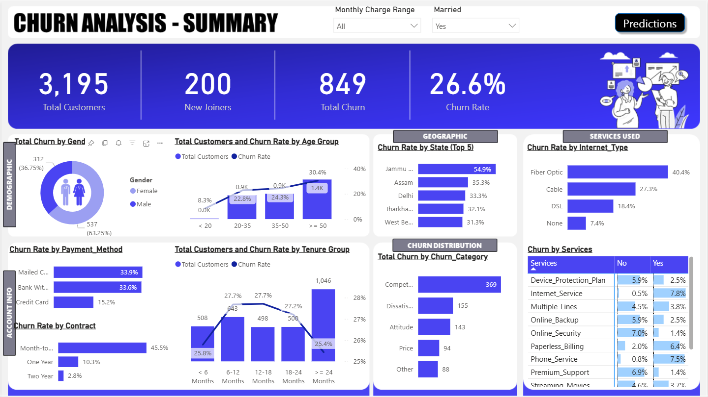
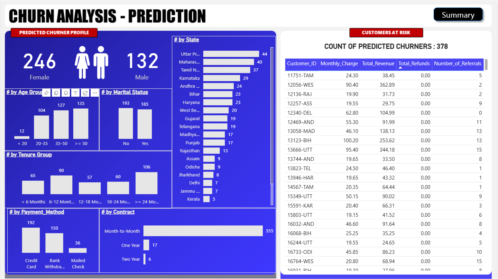

# End-to-End Customer Churn Analysis & Prediction


An end-to-end analytics project that identifies key drivers of customer churn and predicts future churn using a multi-tool stack. This repository contains the SQL scripts for ETL and a Python notebook for predictive machine learning modeling.

---

## 📊 Power BI Dashboard

The final output is an interactive dashboard that provides a high-level summary of churn metrics and a detailed view of customers predicted to churn.




---

## 🎯 Project Goal

The primary objective of this project was to analyze a telecom's customer dataset to understand the primary factors leading to churn. This was followed by building a predictive model to identify at-risk customers, enabling the business to take proactive retention measures.

---

## ⚙️ Architecture & Tech Stack

This project follows a realistic, multi-stage analytics workflow:


1.  **Database & ETL (SQL Server):**
    *   Raw data was loaded into a SQL Server database.
    *   SQL scripts were used for the initial ETL process: cleaning nulls, standardizing categorical data, and performing transformations.

2.  **Predictive Modeling (Python):**
    *   A Jupyter Notebook was used for exploratory data analysis (EDA) and to build the machine learning model.
    *   **Libraries:** Pandas, NumPy, Scikit-learn, Matplotlib, Seaborn.
    *   A **Random Forest Classifier** was trained to predict churn probability for each customer.

3.  **Visualization & Reporting (Power BI):**
    *   Connected to the cleaned SQL database to build the main summary report.
    *   Imported the prediction results from the Python model to create an "Actionable Insights" page, listing high-risk customers.
    *   **Key Features:** DAX Measures, Interactive Slicers, Bookmarks, and Drill-throughs.

---

## 📈 Project Workflow & Key Steps

### 1. ETL & Data Cleaning (SQL)

The raw data was first loaded into a SQL Server table. The following cleaning and transformation steps were performed using SQL:

```sql
-- Example: Creating Views for Power BI
Create View vw_ChurnData as
	select * from prod_Churn where Customer_Status In ('Churned', 'Stayed')


Create View vw_JoinData as
	select * from prod_Churn where Customer_Status = 'Joined'
```

*(The full script can be found in the `/sql/` directory.)*

### 2. Machine Learning Model (Python)

After cleaning the data, a predictive model was built to identify customers likely to churn.

*   **Feature Engineering:** Created new features and encoded categorical variables for the model.
*   **Model Selection:** A Random Forest Classifier was chosen for its high accuracy and ability to handle complex interactions between features.
*   **Evaluation:** The model achieved the following performance on the test set:
    *   **Accuracy:** 71%
    *   **Precision:** 78%
    *   **Recall:** 65%

```python
# Example: Training the Random Forest model
from sklearn.ensemble import RandomForestClassifier

# Instantiate model with 100 decision trees
rf_model = RandomForestClassifier(n_estimators=100, random_state=42)

# Train the model on training data
rf_model.fit(X_train, y_train)
```
*(The full notebook can be found in the `/notebook/` directory.)*

---


## 💡 Future Improvements

*   Deploy the machine learning model as a REST API for real-time predictions.
*   Automate the entire pipeline using a workflow orchestrator like Apache Airflow.
*   Migrate the database and pipeline to a cloud platform like GCP, Azure or AWS.

---